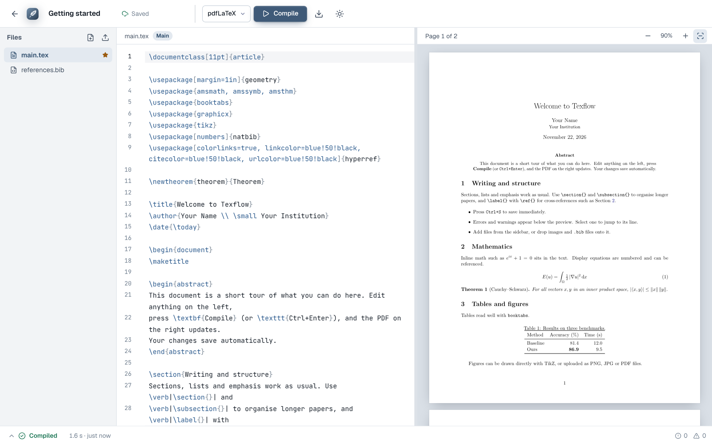
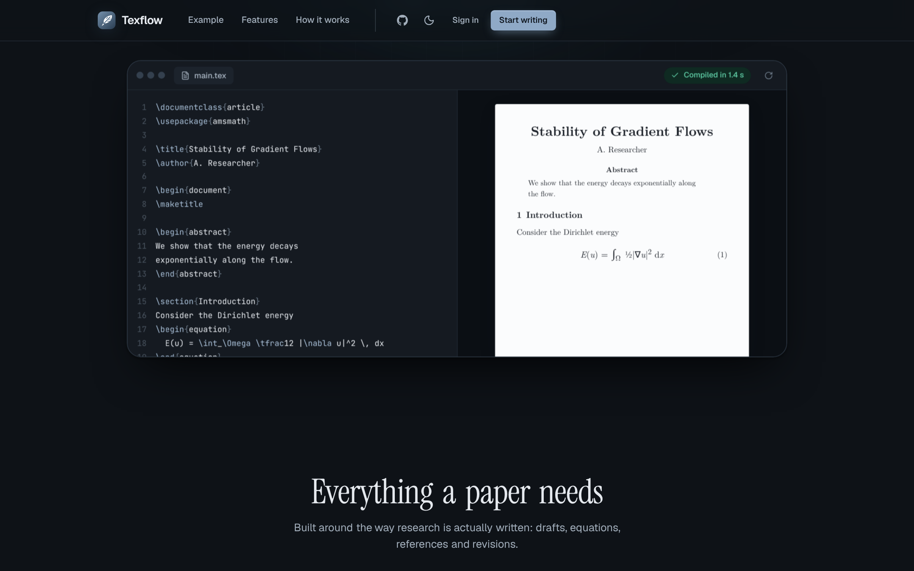
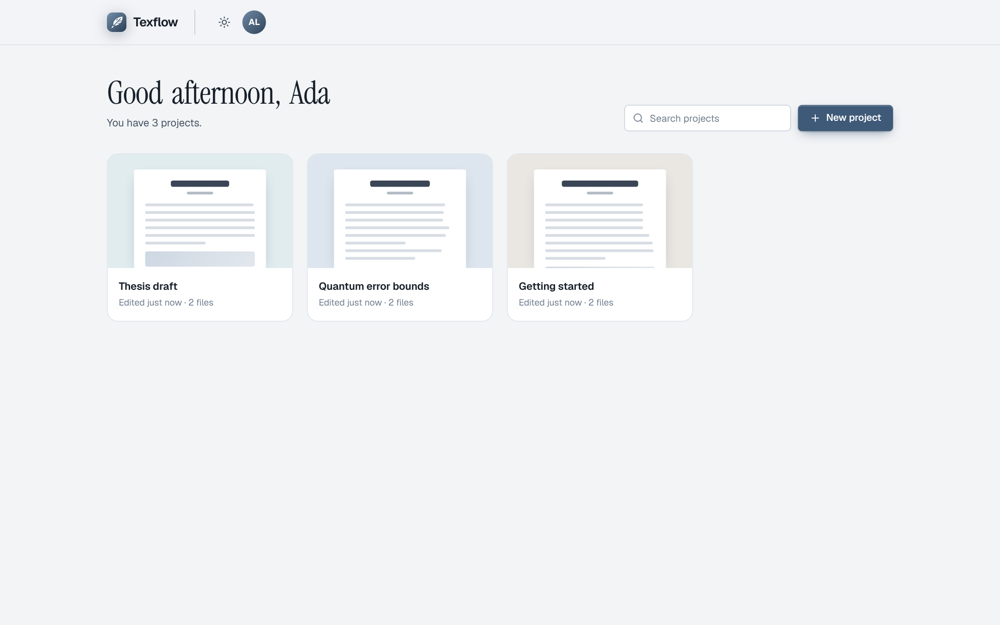

<div align="center">

<picture>
  <source media="(prefers-color-scheme: dark)" srcset="assets/logo-dark.png">
  
</picture>

**A fast, private, browser-based LaTeX editor for researchers.**

Write in the browser, compile in seconds, and keep every draft saved.

[](https://github.com/ritsukasu/texflow/actions/workflows/ci.yml)
[](https://github.com/ritsukasu/texflow/actions/workflows/deploy.yml)




</div>

## Overview

Texflow is a self-hostable LaTeX editor with a live PDF preview. It is built for people who write papers, theses and slides and want an editor that stays out of the way: autosave, errors that point at the right line, citation-aware autocomplete and a calm interface in light and dark.

Every new account starts with an example paper that demonstrates equations, theorems, a table, a TikZ figure and a bibliography, so you can see a full compile within seconds of signing up.

<div align="center">


</div>

## Features

**Writing**
- CodeMirror 6 editor with LaTeX highlighting, bracket matching, search and per-file undo history
- Autocomplete for commands, environments (inserts the matching `\end{}`), packages, `\cite{}` keys read from your `.bib` files, `\ref{}` labels and `\includegraphics{}` files
- Autosave with a visible status, retry when offline, and a warning before you close the tab with unsaved changes
- Multiple files and folders, drag-and-drop figure upload (PNG, JPG, PDF, EPS), rename, delete and a selectable main file

**Building**
- pdfLaTeX and XeLaTeX through `latexmk`, which reruns LaTeX and BibTeX or Biber as needed
- PDF preview rendered with PDF.js, with zoom, fit-to-width, page tracking and lazy page rendering
- Problems panel with file and line numbers. Select an entry to jump to the line, and errors are underlined in the editor
- Full build log, download as PDF, or download the project source as a zip

**Interface**
- Light and dark themes that follow your system and can be overridden
- Skeleton loading, animated transitions, spring-based dialogs and menus, and reduced-motion support
- Responsive layout with a source/preview switch on small screens
- Keyboard shortcuts: `Ctrl/Cmd + Enter` compiles and `Ctrl/Cmd + S` saves immediately

**Operations**
- Single Node process with SQLite storage, no external services
- Per-user quotas, rate limits, a bounded compile queue and graceful shutdown
- Docker image with a full TeX Live installation

## Quick start

Requirements: Node.js 20.19 or newer, and a TeX Live installation that provides `latexmk`, `pdflatex` and `xelatex`.

```bash
git clone https://github.com/ritsukasu/texflow.git
cd texflow
npm install
npm run dev
```

Open <http://localhost:5173>. The dev server proxies API calls to the backend on port 3001.

To run a production build:

```bash
npm run build
npm start
```

Open <http://localhost:3001>.

On Debian or Ubuntu, a suitable TeX installation is:

```bash
sudo apt-get install latexmk texlive-latex-recommended texlive-latex-extra \
  texlive-fonts-recommended texlive-science texlive-pictures texlive-xetex \
  texlive-bibtex-extra biber
```

## Docker

```bash
cp .env.example .env
docker compose up -d --build
```

Texflow listens on port 3001 and stores its data in the `texflow-data` volume. The compose file runs the container as a non-root user with a read-only root filesystem, all Linux capabilities dropped, and memory and process limits.

Put a TLS-terminating reverse proxy in front for any public deployment and set `TRUST_PROXY=1` so session cookies are marked `Secure` and rate limits see real client addresses.

## Deployment with GitHub Actions

Pushing to `main` runs the tests, builds the Docker image, smoke-tests it, publishes it to GitHub Container Registry and, if you enable it, deploys it to your own server over SSH with automatic HTTPS through Caddy.

GitHub Pages cannot host Texflow because it needs a server and TeX Live, so the workflows deliver a container instead. Setup steps, required secrets and variables are in [docs/DEPLOYMENT.md](docs/DEPLOYMENT.md).

## Configuration

All settings are environment variables and all are optional. See [`.env.example`](.env.example).

| Variable | Default | Description |
| --- | --- | --- |
| `PORT` / `HOST` | `3001` / `0.0.0.0` | Address to listen on |
| `DATA_DIR` | `server/data` | SQLite database and build cache |
| `TRUST_PROXY` | `0` | Number of reverse proxies in front of the app |
| `ALLOW_REGISTRATION` | `true` | Set to `false` to close sign-ups on a private instance |
| `SESSION_DAYS` | `30` | Session lifetime |
| `MAX_PROJECTS_PER_USER` | `40` | Projects per account |
| `MAX_FILES_PER_PROJECT` | `80` | Files per project |
| `MAX_TEXT_FILE_BYTES` | `1048576` | Largest editable text file |
| `MAX_UPLOAD_BYTES` | `8388608` | Largest uploaded figure |
| `MAX_PROJECT_BYTES` | `33554432` | Total size of a project |
| `COMPILE_TIMEOUT_MS` | `45000` | Hard limit for one build |
| `COMPILE_CONCURRENCY` | `2` | Builds that may run at once |
| `COMPILE_QUEUE_LIMIT` | `12` | Builds that may wait before new ones are refused |
| `ALLOW_LUALATEX` | `false` | Enable LuaLaTeX, which can run Lua code |

## Security model

Texflow compiles documents written by its users, so the build step is treated as untrusted input.

| Area | What is in place |
| --- | --- |
| Passwords | scrypt with a per-user salt and constant-time comparison. Sign-in does not reveal whether an account exists |
| Sessions | Random 256-bit tokens in `HttpOnly`, `SameSite=Lax` cookies. Only a SHA-256 hash is stored, so a database leak does not expose live sessions |
| CSRF | State-changing requests require a custom header and a same-origin `Origin` |
| Authorization | Every project route checks ownership in the query. Other users' projects return `404`, not `403` |
| Input | Schema validation on every body. File paths use a strict allowlist, with no traversal, no hidden files and a fixed set of extensions. Uploads are checked by magic bytes |
| Headers | Strict CSP, `nosniff`, `frame-ancestors 'none'`, `no-referrer`, HSTS and a same-origin resource policy |
| Builds | Shell escape disabled, TeX file access restricted to the project directory (`openin_any=p`, `openout_any=p`), a scrubbed environment, a throwaway working directory per build, CPU and file-size limits via `prlimit`, a wall-clock timeout that kills the whole process group, and server paths removed from logs |
| Abuse | Rate limits on sign-in, registration, compilation and globally, plus quotas and a bounded compile queue |
| Errors | Clients receive generic messages. Details stay in server logs, and no stack traces are returned |

These controls are covered by the automated tests, including attempts to run `\write18`, read `/etc/passwd`, write outside the project and run an infinite loop.

Process-level restrictions are not a substitute for isolation. For a public instance, run Texflow in the provided container, keep `ALLOW_LUALATEX` off and consider placing it on its own host. To report a vulnerability, see [SECURITY.md](SECURITY.md).

## Architecture

```
texflow/
├── client/                  React 19 + Vite single-page app
│   └── src/
│       ├── pages/           Landing, Auth, Dashboard, Editor (+ editor/ parts)
│       ├── components/      Logo, Modal, Menu, Skeleton, dialogs
│       ├── context/         Theme, Auth, Toast providers
│       └── styles/          Design tokens and page styles
├── server/                  Express 5 API
│   ├── src/
│   │   ├── routes/          auth and projects
│   │   ├── services/        compiler (latexmk sandbox) and store (queries, quotas)
│   │   ├── security.js      hashing, sessions, CSRF
│   │   ├── validation.js    schemas and path rules
│   │   └── db.js            SQLite schema
│   └── test/                Node test runner suites
├── .github/workflows/       ci.yml and deploy.yml
├── deploy/                  Production compose file and Caddyfile
├── scripts/smoke.sh         End-to-end container check
├── Dockerfile
└── docker-compose.yml
```

| Layer | Choice |
| --- | --- |
| Frontend | React, React Router, Framer Motion, CodeMirror 6, PDF.js, Lucide icons |
| Backend | Express, better-sqlite3 (WAL), Zod, Helmet, express-rate-limit |
| Typesetting | TeX Live through `latexmk` |

## API

All endpoints are under `/api`, return JSON errors as `{ "error": { "code", "message" } }` and require the `X-Requested-With: texflow` header on writes.

| Method | Path | Purpose |
| --- | --- | --- |
| `POST` | `/auth/register`, `/auth/login`, `/auth/logout` | Account and session |
| `GET` | `/auth/me` | Current user, or `null` |
| `GET` `POST` | `/projects` | List and create |
| `GET` `PATCH` `DELETE` | `/projects/:id` | Read, update, delete |
| `POST` | `/projects/:id/duplicate` | Copy a project |
| `PUT` `DELETE` | `/projects/:id/file` | Save or delete a text file |
| `POST` | `/projects/:id/upload` | Upload a figure |
| `POST` | `/projects/:id/file/rename` | Rename a file |
| `POST` | `/projects/:id/compile` | Build the project |
| `GET` | `/projects/:id/pdf`, `/source.zip`, `/raw` | Downloads |
| `GET` | `/health` | Liveness check |

## Development

```bash
npm run dev      # API on :3001 and Vite on :5173
npm test         # backend tests, including real LaTeX builds
npm run build    # production client bundle in client/dist
```

The test suite needs a local TeX Live installation because it compiles real documents.

## Limitations

- Single-user editing. There is no real-time collaboration or version history yet
- No SyncTeX click-to-source between the PDF and the editor
- One TeX Live installation, so package availability depends on the host or image

## Contributing

Issues and pull requests are welcome. See [CONTRIBUTING.md](CONTRIBUTING.md).

## License

Released under the [MIT License](LICENSE).
